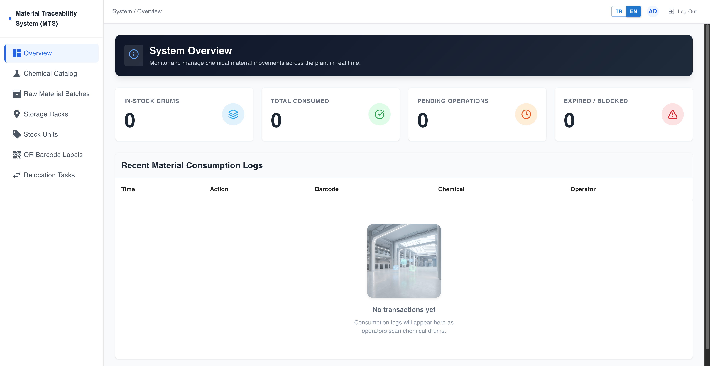
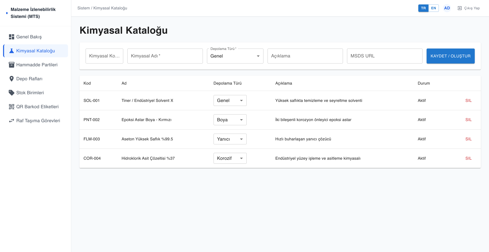
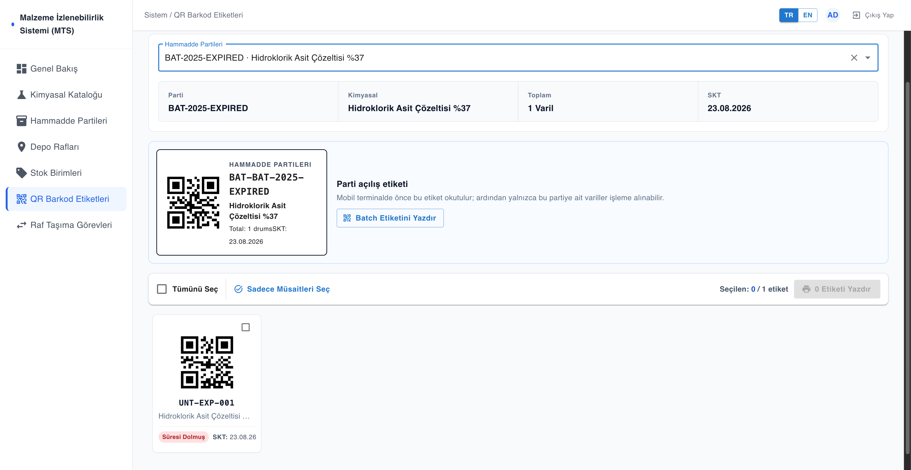
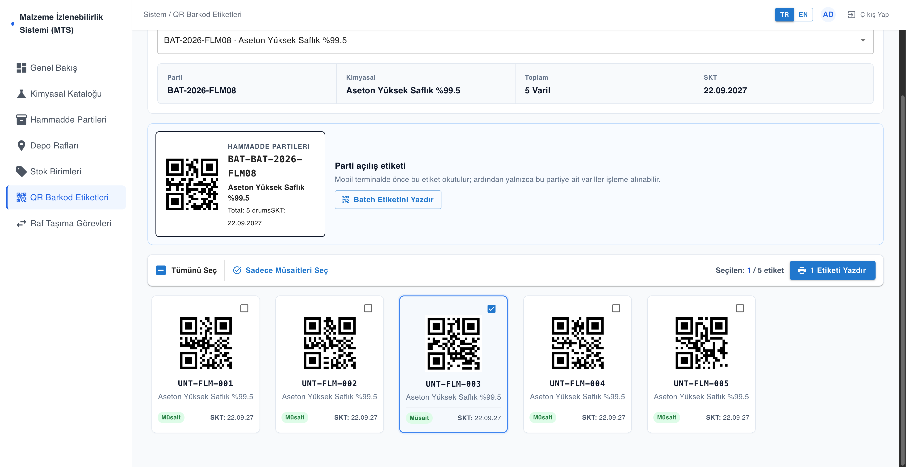
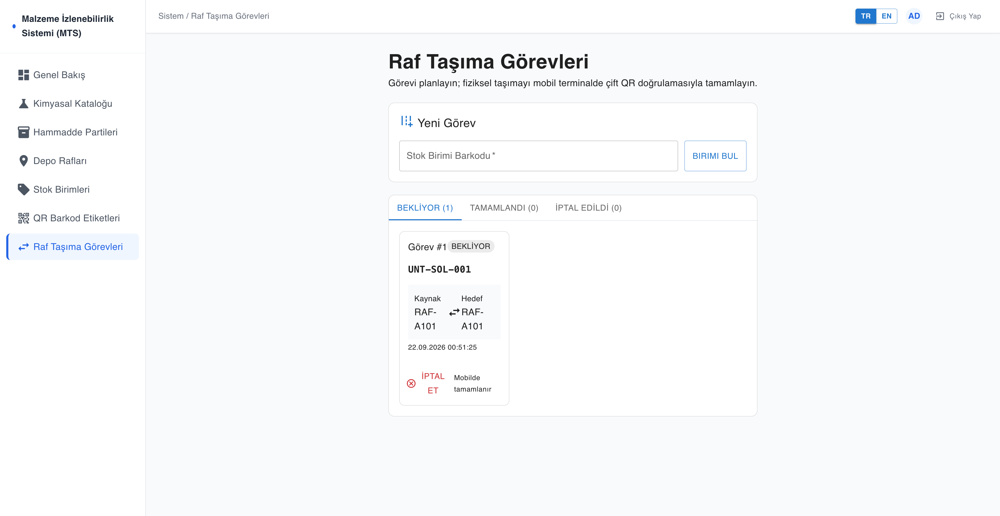
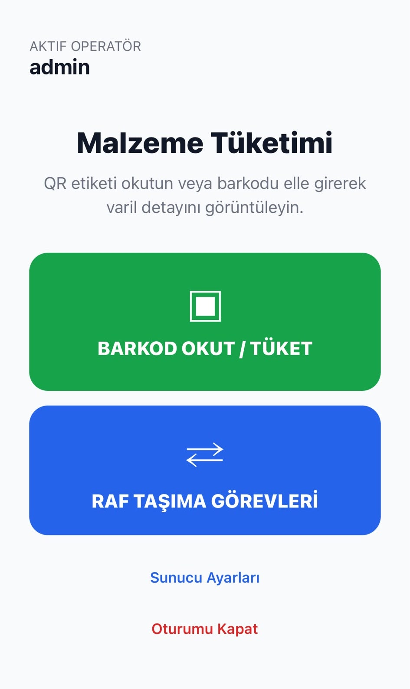

# Material Traceability System (MTS)

Material Traceability System is an end-to-end industrial Warehouse Management System (WMS) ecosystem designed for chemical inventory tracking, lot expiration monitoring, automated shelf capacity verification, dual-code relocation workflows, and barcode-driven mobile terminal operations.

---

## 📸 Screenshots

<p align="center">
  
  
</p>

<p align="center">
  
  
</p>

<p align="center">
  
  
</p>

---

## 🏗️ Architecture & Ecosystem

```text
MaterialTraceabilitySystem/
├── backend/          .NET 10 Web API (EF Core 10, PostgreSQL 16, JWT & RBAC)
├── web-portal/       React + Vite Administration Dashboard (Material UI, Nginx)
├── mobile-terminal/  React Native + Expo Barcode Terminal (Camera, QR & Code 128 Scanner)
├── docs/images/      Repository screenshots and visual assets
├── docker-compose.yml Full-stack Docker orchestration
└── README.md
```

### Tech Stack
- **Backend API:** ASP.NET Core (.NET 10), C# 13, Entity Framework Core 10, PostgreSQL 16, JWT Authentication, Scalar API Docs, QRCoder, BarcodeLib/SkiaSharp.
- **Web Portal:** React 19, Vite, Material UI (MUI), Axios, backend-generated label previews, Nginx.
- **Mobile Terminal:** React Native, Expo Router, Expo Camera (QR and Code 128 scanning), SecureStore, AsyncStorage.
- **Infrastructure:** Docker, Docker Compose, Nginx Reverse Proxy.

---

## 🚀 Quick Start with Docker Compose

Run the ecosystem (PostgreSQL 16, .NET 10 API, React portal, and Caddy HTTPS reverse proxy) with a single command:

```bash
# 1. Copy environment template
cp .env.example .env

# 2. Build and start containers
docker compose up --build -d
```

Only Caddy publishes ports 80 and 443. PostgreSQL, the API, and Nginx stay on the private Compose network. Mailpit is disabled by default; start it only for local email testing with `docker compose --profile dev up --build -d`.

### Physical iOS terminal on the local network

The API is private to the Compose network by default. To connect a physical iPhone during local development, opt in to the LAN-only override and bind the API to the Mac's current Wi-Fi IP (for example, `192.168.1.157`):

```bash
MOBILE_API_BIND_ADDRESS=192.168.1.157 docker compose -f docker-compose.yml -f docker-compose.mobile-dev.yml up -d backend
curl http://192.168.1.157:5059/api/health
```

Keep the phone and Mac on the same Wi-Fi. In the terminal's **Server Connection Settings**, enter `http://192.168.1.157:5059`. If the Mac's LAN IP changes, use the new IP in both commands. The override is development-only and binds the API to the chosen host IP; requests use HTTP, so use a trusted private network. Do not enable this override in production. The iOS app declares local-network access and ATS local-network support in `app.json`; rebuild and reinstall the iOS app after changing those native settings.

`POSTGRES_PASSWORD` initializes the PostgreSQL role only when the data volume is first created. Changing the environment value later does not change the password stored in an existing volume; update the database role and environment together, or provision a separate volume and migrate data before switching.

### Access URLs:
- **Web Dashboard:** `http://localhost`
- **Backend API:** `http://localhost/api`
- **Scalar Interactive API Docs:** available when running the backend in Development at `http://localhost:5059/scalar/v1` (not exposed by the production Compose stack)
- **Mailpit Inbox (development email):** `http://localhost:8025` after starting the `dev` profile
- **Mailpit SMTP:** `localhost:1025` after starting the `dev` profile (the backend uses `mailpit:1025` inside Docker)

---

## 🛠️ Run Services Individually

### 1. Backend API (.NET 10)
```bash
cd backend
dotnet restore
dotnet run
```
*In Development, the database seeds the default roles and the admin user `admin` / `admin123`; use a strong `ADMIN_PASSWORD` outside Development. The `demo` / `demo123` Operator account is enabled by default only in Development.*

### 2. Web Portal (React + Vite)
```bash
cd web-portal
npm ci
npm run dev
```
*Access at `http://localhost:5173` (Vite proxies `/api` and `/hubs` to `http://localhost:5059` by default; set `VITE_DEV_API_TARGET` to override it).*

### 3. Mobile Terminal (Expo)
```bash
cd mobile-terminal
npm ci
npm start
```
*Scan the QR code with Expo Go or run on iOS Simulator / Android Emulator. Set the computer's LAN IP on the Settings screen when testing on physical devices.*

---

## 🌟 Core Features & Automated Validation Rules

- **🔐 Authentication & Authorization:** Secure JWT token authentication with 30-min access tokens, 7-day refresh tokens, and granular Admin/Operator role permissions.
- **🛑 Capacity & Storage Type Verification:** Automatic validation rules that prevent storing chemical materials on incompatible shelf types (`GENERAL`, `SOLVENT`, `PAINT`, `FLAMMABLE`, `CORROSIVE`) or exceeding shelf capacity.
- **🧪 Fictional Demo Inventory:** `DEMO_DATA_ENABLED` seeds a repeatable set of fictional chemicals, batches, stock units, rack addresses, and relocation tasks. It defaults on in Development and off in Production.
- **📦 Batch-First QR Scanning:** Mandatory scanning of a Batch QR (`BAT-{BatchNo}`) before consuming individual units to enforce strict lot governance.
- **📨 Asynchronous Critical Stock Alerts:** Each chemical has a `MinStockThreshold` field (default `10`). When consuming or deleting an in-stock unit takes the chemical’s total active-unit count below the threshold, the backend queues a low-stock event and a background worker sends a formatted HTML email. A relocation checks stock but does not reduce the chemical’s total stock. Administrators can set the notification recipient and enable or disable alerts in **Settings → Critical Stock and Notifications**.
- **🏷️ Configurable QR & Code 128 Labels:** Administrators can choose the default label format in **Settings → Label Format Preference**. QR codes are the default; Code 128 is also available. The backend generates PNG label previews using cross-platform libraries, including in Linux Docker deployments.
- **📱 Multi-format Mobile Scanning:** The mobile terminal camera reads both QR codes and Code 128 barcodes. Existing payloads remain unchanged: batch labels use `BAT-{BatchNo}`, and demo unit labels use `UNIT-DEMO-UNIT-###`. Units created by the batch workflow use `UNIT-{BatchNo}-{index:D3}`; manually created units retain their stored barcode value.
- **🔄 Dual-code Relocation Tasks:** Relocation tasks planned on the web dashboard require warehouse operators to scan both the physical Unit code and the target Address QR (`ADR-{Code}`) on the mobile terminal.
- **🖨️ Label Printing Manager:** Searchable batch selector, batch summary cards, selectable unit grids, and `@media print` layout optimized for A4 label printing. Batch, unit, and address labels use the active system format and backend-generated PNG previews.
- **📷 Smart Batch Onboarding:** Admins and Operators can upload a supplier label photo to extract lot number, expiration date, and a suggested active chemical; the result pre-fills the new-batch form. Saving a batch opens a PNG label preview generated by the existing QR/Code 128 strategy using the system's selected format.
- **🔍 Full-Text Search:** Case-insensitive search across chemicals, batch lot numbers, suppliers, barcodes, and warehouse shelf codes.

### Label Format API

The backend exposes authenticated endpoints for reading the active format, updating it (Admin only), and generating PNG previews:

```text
GET  /api/settings/barcode-format
PUT  /api/settings/barcode-format   { "format": "QrCode" | "Code128" }
GET  /api/labels/preview?payload=BAT-...
```

The active format is stored in the single-row `system_settings` table and defaults to `QrCode`. Label payloads continue to use the existing scanner-compatible text values; changing the visual format does not change the payload.

### Critical Stock Notification API

Notification preferences are stored in the same `system_settings` row. Read access requires authentication; updates and test email delivery are Admin-only:

```text
GET  /api/settings/notifications
PUT  /api/settings/notifications
     { "alertEmailRecipient": "alerts@mts.local", "enableLowStockAlerts": true }
POST /api/settings/test-alert-email
```

The test endpoint sends an email immediately to the configured recipient. In Docker Compose, Mailpit captures outgoing messages for local inspection at `http://localhost:8025`; it does not deliver them to an external mailbox. SMTP defaults are in `backend/appsettings.json`, and Compose overrides the host to `mailpit`. For local backend runs, start a Mailpit instance reachable at `localhost:1025`.

`.env.example` leaves `SMTP_HOST` blank. Compose then falls back to `localhost:1025` inside the backend container; the live deployment has no SMTP relay there, so notification preference reads/updates still work, while the Admin test-email endpoint returns HTTP 503 with an SMTP configuration message. Configure a real SMTP relay for live email delivery. For local email testing, start the Mailpit `dev` profile and set `SMTP_HOST=mailpit`. Low-stock email failures are logged by the background worker and do not terminate it.

The low-stock event is published to an in-memory `System.Threading.Channels` queue and processed by a hosted background service, so the stock request does not wait for SMTP delivery. The current alert is emitted when active stock crosses from at/above the threshold to below it.

### Smart supplier-label OCR

`POST /api/batches/scan-label` accepts a JPEG, PNG, or WebP image up to 10 MB and is available to Admin and Operator roles. It returns OCR raw text, suggested chemical match, lot number, expiration date, and the internal `BAT-{lot}` payload. Lot labels include `LOT`, `BATCH`, `PARTI`/`PARTİ`, and `P.NO`; expiration labels include `EXP`, `SKT`, and `BBD` with day/month/year, ISO date, or month/year formats. The user reviews the suggestions before saving.

The Compose deployment runs an open-source PaddleOCR (PP-OCRv4) FastAPI service locally. The `ocr-service` container is attached only to an internal Docker network shared with the backend, has no published host port, and handles OCR at `http://ocr-service:8080/ocr`. The backend sends the uploaded image as multipart field `file`, then passes the returned text to the label parser. The Docker image caches the English recognition, detection, and angle-classifier model weights during image build, so OCR inference does not contact an external service or download models at runtime. The health endpoint is available to Docker at `http://ocr-service:8080/health`.

In Development outside Compose, `Ocr:Mode=Sample` (configured in `appsettings.Development.json`) remains available for parser/UI tests and returns fixture text without inspecting the uploaded image. Compose explicitly uses `OCR_MODE=Remote` and the local OCR service. If the service is unavailable or returns invalid output, scan returns HTTP 503 with an OCR provider message. No external OCR API or API key is needed by the default deployment.

---

## Live Demo

For the intentionally public demo, enable both `DEMO_USER_ENABLED=true` and `DEMO_DATA_ENABLED=true`. Sign in with the operational account **demo / demo123**. It has the `Operator` role: it can browse inventory, receive supplier deliveries by creating batches, create and complete relocation tasks, and consume stock. Chemical, address, and stock-unit administration, relocation-task cancellation, user management, and system settings remain Admin-only. Batch creation validates the selected active chemical and available storage capacity. The account and data flags default off in Production; never use the sample password for an administrator account.

Try these predictable, entirely fictional barcode values:

- Batch: `BAT-DEMO-BAT-002` (near expiry)
- Unit: `UNIT-DEMO-UNIT-001`
- Destination rack: `ADR-DEMO-RACK-SOL-02`

The demo inventory is reset daily by the guarded reset script. Reset removes business inventory only; admin/demo accounts, roles, refresh tokens, and system settings are preserved. It writes a PostgreSQL backup before deletion and retains the two newest backups. Restrict this automation to a demo-only deployment because it clears all business rows in the listed tables.

---

## Security

This repository applies **baseline security hardening for a public demo**. It is not a claim of production-grade security.

### Protections in place

- Caddy is the only public Compose service and publishes ports 80/443. The database, API, and portal communicate over a private Docker network; PostgreSQL uses a named volume and publishes no host port.
- Mailpit runs only with the `dev` Compose profile and binds its UI/SMTP ports to loopback.
- Caddy obtains HTTPS certificates for public DNS names configured through `DOMAIN`; `localhost` uses Caddy's local certificate. The web portal calls the API through relative `/api` and `/hubs` paths, so browser requests remain on the Caddy origin. Vite uses `VITE_DEV_API_TARGET` for local development.
- Production startup requires configured `JWT_SECRET`, `ADMIN_PASSWORD`, and a non-default PostgreSQL connection password. Keep real values in an untracked `.env` file or deployment secret store; `.env.example` contains placeholders only.
- CORS uses the comma-separated `ALLOWED_ORIGINS` list in Production. The app trusts forwarded client IP and scheme only from Caddy's fixed private Compose address.
- Login endpoints allow ten attempts per client IP per 60 seconds by default. Override with `RateLimiting__Login__PermitLimit` and `RateLimiting__Login__WindowSeconds`. A short fixed window means clients sharing a public IP can affect one another. A second in-memory failure counter also throttles non-demo username/IP pairs after five failures for one minute; it is process-local and resets on restart. The demo account bypasses that username-based counter but remains covered by IP limiting.
- Production API errors return a generic message without stack traces. Caddy sets `X-Content-Type-Options`, `X-Frame-Options`, `Referrer-Policy`, and HSTS (`max-age=31536000`, without `includeSubDomains` or `preload`). API documentation endpoints are mapped only in Development.
- The seed creates the `admin` account with a hash of `ADMIN_PASSWORD` only when no user has the Admin role. If another Admin exists, the `admin` account is left untouched even if it was deleted, deactivated, or demoted. `DEMO_USER_ENABLED` controls the demo Operator; it defaults off in Production and on in Development.
- **Emergency admin reset:** set `ADMIN_PASSWORD_RESET=true` together with the new `ADMIN_PASSWORD` for one startup to create the `admin` account if missing or restore it if inactive/roleless, re-hash its password, and revoke its active refresh tokens. Remove the flag immediately afterward; leaving it enabled resets the password and terminates admin sessions on every restart.
- `scripts/reset-demo.sh` supports public-domain demo hosts as well as localhost. Removing the localhost-only check adds no remotely callable endpoint: a reset still requires host-side execution with Docker access, `DEMO_DATA_ENABLED=true` in both the invoking environment and running backend, and the explicit `--confirm-demo-reset` argument. These checks limit accidental use, but the operator must still restrict the script and its full-database backups to a demo deployment; enabling the flag against production data and confirming will erase business rows.

### Endpoint → role matrix

Unless marked public, API endpoints require an authenticated access token. **Admin** and **Operator** identify application roles. Unlisted verbs/routes are not defined by the API.

| Endpoint | Method | Required role |
|---|---|---|
| `/api/auth/login`, `/api/auth/login-web` | POST | Public; IP rate limited |
| `/api/auth/refresh`, `/api/auth/logout` | POST | Public (refresh token required) |
| `/api/auth/change-password` | POST | Public; username + current password required; IP rate limited |
| `/api/health` | GET | Public |
| `/api/safetyassistant/ask` | POST | Public |
| `/api/chemicals`, `/api/chemicals/{id}` | GET | Admin, Operator |
| `/api/chemicals`, `/api/chemicals/{id}` | POST, PUT, DELETE | Admin |
| `/api/batches`, `/api/batches/{id}`, `/api/batches/{id}/units`, `/api/batches/barcode/{barcode}` | GET | Admin, Operator |
| `/api/batches` | POST | Admin, Operator |
| `/api/batches/scan-label` | POST | Admin, Operator |
| `/api/addresses`, `/api/addresses/{id}` | GET | Admin, Operator |
| `/api/addresses` | POST, DELETE `/api/addresses/{id}`, PUT `/api/addresses/{id}/storage-type`, PUT `/api/addresses/{id}/capacity` | Admin |
| `/api/units`, `/api/units/barcode/{barcode}`, `/api/units/address/{addressId}` | GET | Admin, Operator |
| `/api/units` | POST, DELETE `/api/units/{barcode}` | Admin |
| `/api/units/{barcode}/consume` | POST | Admin, Operator |
| `/api/relocation-tasks`, `/api/relocation-tasks/eligible-targets/{unitId}` | GET | Admin, Operator |
| `/api/relocation-tasks` | POST | Admin, Operator |
| `/api/relocation-tasks/{id}/complete` | PUT | Admin, Operator |
| `/api/relocation-tasks/{id}/cancel` | PUT | Admin |
| `/api/settings/barcode-format`, `/api/settings/notifications` | GET | Admin, Operator |
| `/api/settings/barcode-format`, `/api/settings/notifications`, `/api/settings/test-alert-email` | PUT, PUT, POST | Admin |
| `/api/labels/preview` | GET | Admin, Operator |
| `/api/dashboard/aggregate`, `/api/dashboard/pending`, `/api/dashboard/recent-consumption` | GET | Admin, Operator |
| `/api/warehouses` | GET | Admin, Operator |
| `/api/shops` | GET | Admin, Operator |
| `/api/types` | GET | Admin, Operator |
| `/api/sectors` | GET | Admin, Operator |
| `/api/stock-limits` | GET | Admin, Operator |
| `/api/status` | GET | Admin, Operator |
| `/api/material-parties` | GET | Admin, Operator |
| `/api/users` | GET, POST | Admin |
| `/api/users/{id}` | GET, DELETE | Admin |
| `/api/users/{id}/role`, `/api/users/{id}/active` | PUT | Admin |
| `/api/users/{id}/reset-password` | POST | Admin |

`/api/safetyassistant/ask` is anonymous and limited to ten requests per client IP per 60 seconds by default. Override it with `RateLimiting__SafetyAssistant__PermitLimit` and `RateLimiting__SafetyAssistant__WindowSeconds`. The service calls local Ollama at `http://localhost:11434` using Qwen and Nomic models; it contains no paid external API integration or API key, and Compose does not start an Ollama service. In the live deployment, Ollama is therefore unavailable and SafetyAssistant responds in fallback mode.

### Resetting demo data

The EF Core database has these application tables (plus PostgreSQL's `public.__EFMigrationsHistory`, which EF Core uses to track schema migrations):

| Table | Reset behavior | Reason |
|---|---|---|
| `relocation_tasks` | Cleared | Demo workflow tasks refer to units and addresses; clear first. |
| `units` | Cleared | Demo stock units refer to batches and may point to addresses. |
| `batches` | Cleared | Demo batches refer to chemicals. |
| `chemicals` | Cleared | Demo catalog records are recreated by the seeder. |
| `addresses` | Cleared | Demo warehouse/rack locations are recreated after dependent rows are cleared. |
| `users` | Preserved | Admin and demo accounts must remain available. |
| `roles` | Preserved | Authorization roles remain linked to users. |
| `user_roles` | Preserved | User-to-role assignments must remain intact. |
| `refresh_tokens` | Preserved | Authentication state is retained; users are not deleted. |
| `system_settings` | Preserved | Barcode and notification preferences are system configuration. |
| `__EFMigrationsHistory` | Preserved | EF Core schema migration tracking is not business/demo data. |

The reset clears the five business tables (`relocation_tasks`, `units`, `batches`, `chemicals`, `addresses`) in one transaction and in child-to-parent foreign-key order. No orphan rows are left: all rows that reference those business records are cleared in the same transaction, while user and role references are preserved. It creates a full `pg_dump` before deletion, including user password hashes, stores it under the ignored `backups/demo-reset/` directory with directory mode `0700` and dump-file mode `0600`, retains the two newest backups, restarts the backend to reseed data, and verifies `/api/health`. It does not remove the PostgreSQL volume or publish the database port. Run it only on a demo instance, because user-created business rows in the listed tables are also cleared.

An intentional one-off invocation is:

```bash
DEMO_DATA_ENABLED=true ./scripts/reset-demo.sh --env-file /etc/mts/demo.env --confirm-demo-reset
```

The script exits without touching the database unless the flag and explicit confirmation are both present and the running backend also has `DEMO_DATA_ENABLED=true`. To schedule a daily reset, an operator may add a cron entry on the demo host; this repository does not install or configure cron:

```cron
0 4 * * * DEMO_DATA_ENABLED=true /absolute/path/to/MaterialTraceabilitySystem/scripts/reset-demo.sh --env-file /etc/mts/demo.env --confirm-demo-reset >> /var/log/mts-demo-reset.log 2>&1
```

The 04:00 schedule targets a low-traffic period. The reset restarts the backend, so users may see a brief service interruption while the demo data is reseeded and health checks recover.

### Deliberately deferred

- No Content Security Policy (CSP) is set because an incorrect policy can block the existing React app; review the app's inline/eval and asset needs before adding one.
- This change does not add Trivy image scanning, a full-history Gitleaks scan, PostgreSQL backups, fail2ban, or VPS SSH hardening. These are deployment follow-ups.
- The backend container already uses a non-root runtime user; no additional container user changes were made as part of this hardening work.

---

## 🧪 Testing

```bash
# Web Portal Unit Tests
cd web-portal && npm test

# Mobile Terminal Unit Tests
cd mobile-terminal && npm test

# Backend tests (SQLite tests plus PostgreSQL Testcontainers tests)
dotnet test backend.Tests/backend.Tests.csproj

# Testcontainers tests require Docker; omit them with this filter when Docker is unavailable
dotnet test backend.Tests/backend.Tests.csproj --filter "Category!=Testcontainers"

# Backend Solution Build
cd backend && dotnet build
```
