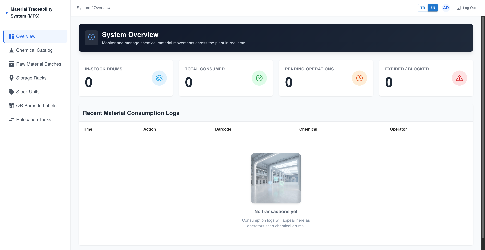
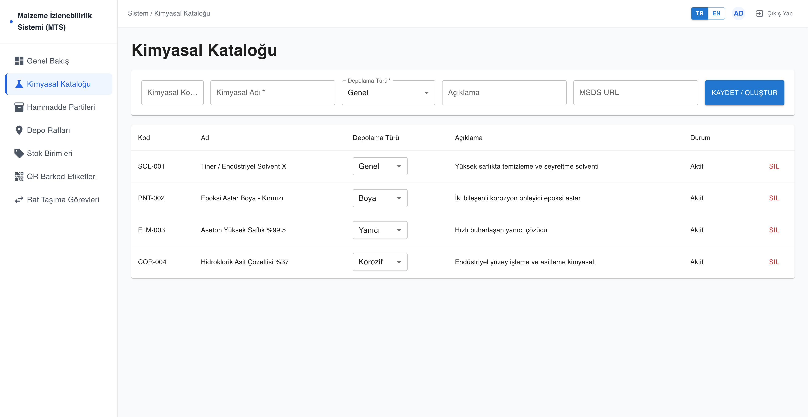
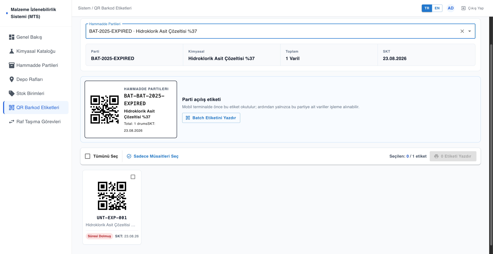
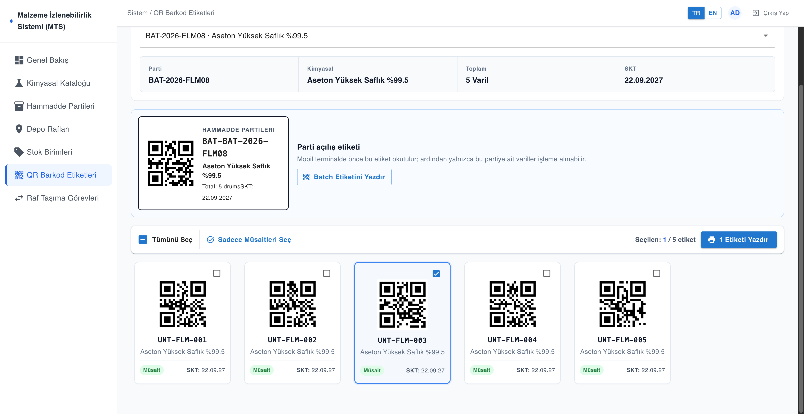
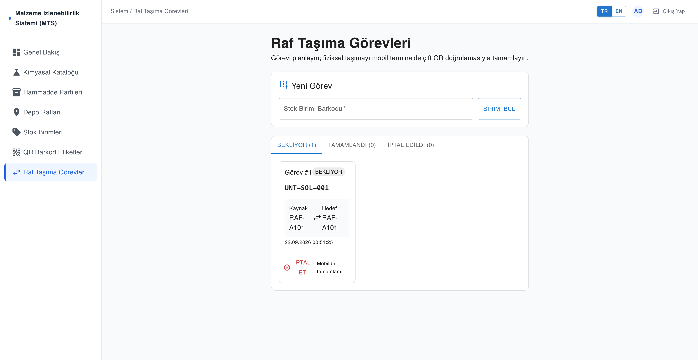
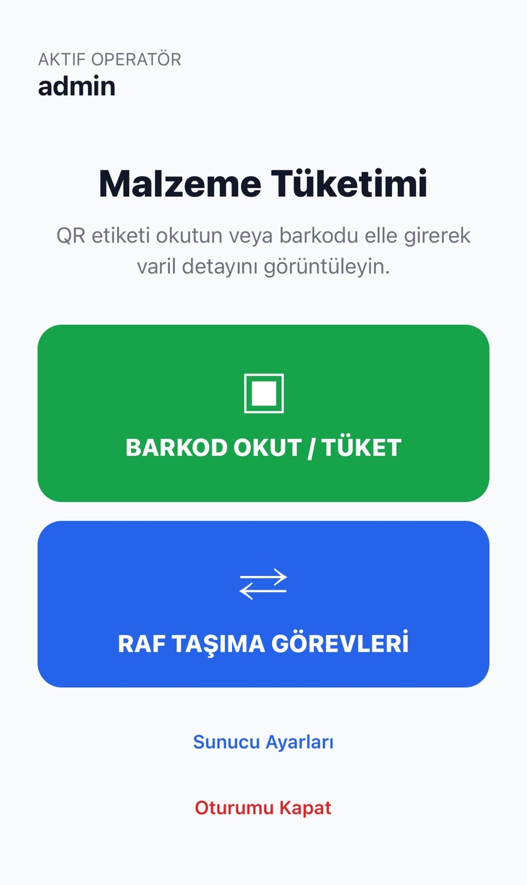

# Material Traceability System (MTS)

Material Traceability System is an end-to-end industrial Warehouse Management System (WMS) ecosystem designed for chemical inventory tracking, lot expiration monitoring, automated shelf capacity verification, dual-code relocation workflows, and barcode-driven mobile terminal operations.

---

## 📸 Screenshots

<p align="center">
  
  
</p>

<p align="center">
  
  
</p>

<p align="center">
  
  
</p>

---

## 🏗️ Architecture & Ecosystem

```text
MaterialTraceabilitySystem/
├── backend/          .NET 10 Web API (EF Core 10, PostgreSQL 16, JWT & RBAC)
├── web-portal/       React + Vite Administration Dashboard (Material UI, Nginx)
├── mobile-terminal/  React Native + Expo Barcode Terminal (Camera, QR & Code 128 Scanner)
├── docs/images/      Repository screenshots and visual assets
├── docker-compose.yml Full-stack Docker orchestration
└── README.md
```

### Tech Stack
- **Backend API:** ASP.NET Core (.NET 10), C# 13, Entity Framework Core 10, PostgreSQL 16, JWT Authentication, Scalar API Docs, QRCoder, BarcodeLib/SkiaSharp.
- **Web Portal:** React 19, Vite, Material UI (MUI), Axios, backend-generated label previews, Nginx.
- **Mobile Terminal:** React Native, Expo Router, Expo Camera (QR and Code 128 scanning), SecureStore, AsyncStorage.
- **Infrastructure:** Docker, Docker Compose, Nginx Reverse Proxy.

---

## 🚀 Quick Start with Docker Compose

Run the ecosystem (PostgreSQL 16, .NET 10 API, React portal, and Caddy HTTPS reverse proxy) with a single command:

```bash
# 1. Copy environment template
cp .env.example .env

# 2. Build and start containers
docker compose up --build -d
```

Only Caddy publishes ports 80 and 443. PostgreSQL, the API, and Nginx stay on the private Compose network. Mailpit is disabled by default; start it only for local email testing with `docker compose --profile dev up --build -d`.

`POSTGRES_PASSWORD` initializes the PostgreSQL role only when the data volume is first created. Changing the environment value later does not change the password stored in an existing volume; update the database role and environment together, or provision a separate volume and migrate data before switching.

### Access URLs:
- **Web Dashboard:** `http://localhost`
- **Backend API:** `http://localhost/api`
- **Scalar Interactive API Docs:** available when running the backend in Development at `http://localhost:5059/scalar/v1` (not exposed by the production Compose stack)
- **Mailpit Inbox (development email):** `http://localhost:8025` after starting the `dev` profile
- **Mailpit SMTP:** `localhost:1025` after starting the `dev` profile (the backend uses `mailpit:1025` inside Docker)

---

## 🛠️ Run Services Individually

### 1. Backend API (.NET 10)
```bash
cd backend
dotnet restore
dotnet run
```
*In Development, the database seeds the default roles and the admin user `admin` / `admin123`. Outside Development, `ADMIN_PASSWORD` is only required for the first startup when no active Admin exists, or when `ADMIN_PASSWORD_RESET=true`; after the first admin is created it can be removed. The `demo` / `demo123` Operator account is enabled by default only in Development.*

### 2. Web Portal (React + Vite)
```bash
cd web-portal
npm ci
npm run dev
```
*Access at `http://localhost:5173` (Vite proxies `/api` and `/hubs` to `http://localhost:5059` by default; set `VITE_DEV_API_TARGET` to override it).*

### 3. Mobile Terminal (Expo)
```bash
cd mobile-terminal
npm ci
npm start
```
*Scan the QR code with Expo Go or run on iOS Simulator / Android Emulator. Set the computer's LAN IP on the Settings screen when testing on physical devices.*

---

## 🌟 Core Features & Automated Validation Rules

- **🔐 Authentication & Authorization:** Secure JWT token authentication with 30-min access tokens, 7-day refresh tokens, and granular Admin/Operator role permissions.
- **🛑 Capacity & Storage Type Verification:** Automatic validation rules that prevent storing chemical materials on incompatible shelf types (`GENERAL`, `SOLVENT`, `PAINT`, `FLAMMABLE`, `CORROSIVE`) or exceeding shelf capacity.
- **🧪 Fictional Demo Inventory:** `DEMO_DATA_ENABLED` seeds a repeatable set of fictional chemicals, batches, stock units, rack addresses, and relocation tasks. It defaults on in Development and off in Production.
- **📦 Batch-First QR Scanning:** Mandatory scanning of a Batch QR (`BAT-{BatchNo}`) before consuming individual units, enforced by the consume API as well as the mobile UI, to enforce strict lot governance.
- **📨 Asynchronous Critical Stock Alerts:** Each chemical has a `MinStockThreshold` field (default `10`). When consuming or deleting an in-stock unit takes the chemical’s total active-unit count below the threshold, the backend queues a low-stock event and a background worker sends a formatted HTML email. A relocation checks stock but does not reduce the chemical’s total stock. Administrators can set the notification recipient and enable or disable alerts in **Settings → Critical Stock and Notifications**.
- **📊 Dashboard Alerts:** The dashboard lists in-stock batches that expire within 30 days and chemicals whose active-unit count is below `MinStockThreshold` (`GET /api/dashboard/alerts`). Each list shows at most 10 rows together with the total (for example `10 / 14`). The low-stock count includes units that are still in stock even if their batch has expired, matching the email alert.
- **🏷️ Configurable QR & Code 128 Labels:** Administrators can choose the default label format in **Settings → Label Format Preference**. QR codes are the default; Code 128 is also available. The backend generates PNG label previews using cross-platform libraries, including in Linux Docker deployments.
- **📱 Multi-format Mobile Scanning:** The mobile terminal camera reads both QR codes and Code 128 barcodes. Existing payloads remain unchanged: batch labels use `BAT-{BatchNo}`, and demo unit labels use `UNIT-DEMO-UNIT-###`. Units created by the batch workflow use `UNIT-{BatchNo}-{index:D3}`; manually created units retain their stored barcode value.
- **🔄 Dual-code Relocation Tasks:** Relocation tasks planned on the web dashboard require warehouse operators to scan both the physical Unit code and the target Address QR (`ADR-{Code}`) on the mobile terminal.
- **🖨️ Label Printing Manager:** Searchable batch selector, batch summary cards, selectable unit grids, and `@media print` layout optimized for A4 label printing. Batch, unit, and address labels use the active system format and backend-generated PNG previews.
- **📷 Smart Batch Onboarding:** Admins and Operators can upload a supplier label photo to extract lot number, expiration date, and a suggested active chemical; the result pre-fills the new-batch form. Saving a batch opens a PNG label preview generated by the existing QR/Code 128 strategy using the system's selected format.
- **🔍 Full-Text Search:** Case-insensitive search across chemicals, batch lot numbers, suppliers, barcodes, and warehouse shelf codes.

### Label Format API

The backend exposes authenticated endpoints for reading the active format, updating it (Admin only), and generating PNG previews:

```text
GET  /api/settings/barcode-format
PUT  /api/settings/barcode-format   { "format": "QrCode" | "Code128" }
GET  /api/labels/preview?payload=BAT-...
```

The active format is stored in the single-row `system_settings` table and defaults to `QrCode`. Label payloads continue to use the existing scanner-compatible text values; changing the visual format does not change the payload.

### Critical Stock Notification API

Notification preferences are stored in the same `system_settings` row. Read access requires authentication; updates and test email delivery are Admin-only:

```text
GET  /api/settings/notifications
PUT  /api/settings/notifications
     { "alertEmailRecipient": "alerts@mts.local", "enableLowStockAlerts": true }
POST /api/settings/test-alert-email
```

The test endpoint sends an email immediately to the configured recipient.

`.env.example` leaves `SMTP_HOST` blank, and Compose passes the blank value to the backend, which means email is not configured. Notification preference reads/updates still work, low-stock emails are skipped (the background worker logs one "SMTP not configured" warning and then skips silently), and the Admin test-email endpoint returns HTTP 503 with an SMTP configuration message.

To try email locally, set `SMTP_HOST=mailpit` (port `1025`) in `.env` and start the `dev` profile with `docker compose --profile dev up -d --build`. Mailpit captures outgoing messages at `http://localhost:8025` and does not deliver them to an external mailbox. When running the backend with `dotnet run`, the defaults in `backend/appsettings.json` point to a Mailpit instance at `localhost:1025`. If an SMTP relay is configured but fails, the error is logged and the background worker keeps running.

The low-stock event is published to an in-memory `System.Threading.Channels` queue and processed by a hosted background service, so the stock request does not wait for SMTP delivery. The current alert is emitted when active stock crosses from at/above the threshold to below it.

### Smart supplier-label OCR

`POST /api/batches/scan-label` accepts a JPEG, PNG, or WebP image up to 10 MB and is available to Admin and Operator roles. It returns OCR raw text, suggested chemical match, lot number, expiration date, and the internal `BAT-{lot}` payload. Lot labels include `LOT`, `BATCH`, `PARTI`/`PARTİ`, and `P.NO`; expiration labels include `EXP`, `SKT`, and `BBD` with day/month/year, ISO date, or month/year formats. The user reviews the suggestions before saving.

**OCR is optional and off by default** (`OCR_ENABLED=false` in `.env.example`); the rest of the system works the same without it. While OCR is disabled, `scan-label` returns HTTP 503 with `errorCode: "OCR_DISABLED"` and users enter batch details by hand. To try OCR locally, set `OCR_ENABLED=true` and start the `ocr` Compose profile (`docker compose --profile ocr up`):

```bash
OCR_ENABLED=true docker compose --profile ocr up -d --build   # or set OCR_ENABLED=true in .env
```

The backend does not wait for the OCR container and starts normally without it. If OCR is enabled but the service is unreachable or fails, `scan-label` returns HTTP 503 with `errorCode: "OCR_UNAVAILABLE"` (no stack trace). Timeouts are short: `Ocr__ConnectTimeoutSeconds` (3 s) and `Ocr__TimeoutSeconds` (20 s total, CPU OCR included). The `ocr-service` image is pinned to `linux/amd64` (see the comment in `docker-compose.yml`); on ARM hosts it runs under emulation and is slower.

With the `ocr` profile, Compose runs an open-source PaddleOCR (PP-OCRv4) FastAPI service locally. The `ocr-service` container is attached only to an internal Docker network shared with the backend, has no published host port, and handles OCR at `http://ocr-service:8080/ocr`. The backend sends the uploaded image as multipart field `file`, then passes the returned text to the label parser. The Docker image caches the English recognition, detection, and angle-classifier model weights during image build, so OCR inference does not contact an external service or download models at runtime. The health endpoint is available to Docker at `http://ocr-service:8080/health`.

In Development outside Compose, `Ocr:Mode=Sample` (configured in `appsettings.Development.json`) remains available for parser/UI tests and returns fixture text without inspecting the uploaded image. Compose uses `OCR_MODE=Remote` and the local OCR service when OCR is enabled. No external OCR API or API key is needed.

### İçe aktarma (Chemical Excel import)

Admin-only. The **Chemicals** page has *Download template* and *Bulk import* buttons, which are visible only to Admins.

```text
GET  /api/chemicals/excel-template            → .xlsx: "Kimyasallar" sheet (headers + 1 example row) and a "Kılavuz" guide sheet
POST /api/chemicals/bulk-import?dryRun=true   → preview only, nothing is written
POST /api/chemicals/bulk-import               → real import (multipart field `file`)
```

- **Preview first:** the response lists total, to-add (`insertCount`), skipped, and invalid counts, a status per row (`Insert`/`Skip`/`Error`), and errors per row (row, column, message).
- **All-or-nothing:** if any row is invalid, no row is saved and the API returns `422` with the same report. Otherwise all new rows are saved in one transaction.
- **Existing codes are skipped:** chemicals already in the system (codes compared without case, trimmed) are reported as `Skip` and never updated. Importing the same file twice is safe.
- **Validation:** code (≤ 50), name (≤ 200), and storage type (`GENERAL`, `SOLVENT`, `PAINT`, `FLAMMABLE`, `CORROSIVE`) are required. The threshold must be an integer from 0 to 1,000,000 (default 10). The description can be ≤ 2000 characters. Codes must not repeat within the file.
- **File checks:** only real `.xlsx` files are accepted. The content is checked (ZIP signature plus OOXML spreadsheet content type), not just the file name. `.xlsm`/VBA projects, `.xls`, `.csv`, and renamed files are rejected. The upload is read in memory and never written to disk, and the file name is not logged.
- **Limits** (configurable): `ExcelImport__MaxFileBytes` (2 MB), `ExcelImport__MaxRows` (1000), `ExcelImport__MaxUncompressedBytes` (50 MB total declared unpacked size) and `ExcelImport__MaxArchiveEntries` (100 entries). These two zip-bomb limits are checked from the ZIP headers only, before any entry is unpacked, and rejected with 400; .NET's `ZipArchive` never inflates an entry past its declared size, so a forged header cannot bypass them. The rate limit is 5 requests per IP per 60 s: `RateLimiting__ExcelImport__PermitLimit` / `RateLimiting__ExcelImport__WindowSeconds`. A preview plus a confirm uses 2 requests. These variables are not passed by `docker-compose.yml` by default. The web UI shows the default 2 MB / 1000 limits.
- **Formulas:** formulas and macros are never executed; cells are read as plain text (the cached value). The inventory Excel export prefixes user-supplied text that starts with `=`, `+`, `-`, `@`, tab, or CR with `'` to prevent formula injection.

**Behavior changes compared with the first version of bulk import:** a partial import (valid rows saved, invalid rows reported) is now **all-or-nothing**. A code that already exists is now **skipped** instead of reported as an error. The template is now **Admin-only** (it was available to Operators). The limits went from 10 MB / 10,000 rows to **2 MB / 1000 rows**. The response replaces `successCount` with `dryRun`, `committed`, `insertCount`, `skippedCount`, and `rows`.

---

## Local Demo

There is no hosted instance; the demo runs on your machine with Docker Compose:

```bash
cp .env.example .env
# In .env: replace the REPLACE_WITH_... placeholders (e.g. openssl rand -base64 48) and set
#   DEMO_USER_ENABLED=true
#   DEMO_DATA_ENABLED=true
#   DOMAIN=localhost          # required: the example value is a public placeholder domain
docker compose up -d --build
```

Open `http://localhost`. `DOMAIN` must be `localhost` (or removed, which defaults to `localhost`); otherwise Caddy only serves the configured public name and tries to obtain a public certificate for it. With `localhost`, Caddy uses its own local certificate, so `http://localhost` redirects to `https://localhost` and the browser shows a certificate warning the first time (for command-line checks use `curl -k https://localhost/api/health`).

To sign in as administrator, use the username `admin` with the `ADMIN_PASSWORD` value from your `.env`.

The Compose backend runs in Production mode, where both demo flags default off, so they must be set explicitly. Sign in with the operational account **demo / demo123**. It has the `Operator` role: it can browse inventory, export the inventory Excel report, receive supplier deliveries by creating batches, create and complete relocation tasks, and consume stock. Chemical, address, and stock-unit administration, the chemical Excel template and bulk import, relocation-task cancellation, user management, and settings changes remain Admin-only. Batch creation validates the selected active chemical and available storage capacity. Never use the sample password for an administrator account.

Try these predictable, entirely fictional barcode values:

Consume example:

- Batch (consume flow): `BAT-DEMO-BAT-001`
- Unit (consume flow): `UNIT-DEMO-UNIT-001`
- Near-expiry batch example: `BAT-DEMO-BAT-002` (expires 10 days after seeding; listed under the dashboard's expiring-soon panel)

Consume için birimin kendi batch'i okutulmalı (BATCH_MISMATCH). For consume, the unit's own batch must be scanned (BATCH_MISMATCH).

The demo seed gives each chemical its own threshold, so the dashboard's low-stock panel starts with two chemicals below threshold (`DEMO-CHM-03`, `DEMO-CHM-10`) and one out of stock (`DEMO-CHM-04`). `DEMO-CHM-01` starts exactly at its threshold (3 units); consuming `UNIT-DEMO-UNIT-001` moves it below and queues a low-stock email (skipped with a single warning while `SMTP_HOST` is blank). Thresholds are written only when a demo chemical is first created; an existing demo database keeps its old values until it is reset.

Relocation example (create a relocation task first):

- Unit: `UNIT-DEMO-UNIT-002`
- Current rack: `ADR-DEMO-RACK-GEN-01`
- Destination rack (relocation): `ADR-DEMO-RACK-GEN-02`

To start over with fresh demo data, run the guarded reset script (see [Resetting demo data](#resetting-demo-data)).

---

## Security

Baseline security hardening intended for a publicly exposed demo; the project currently runs locally. Not a claim of production-grade security.

### Protections in place

- Caddy is the only public Compose service and publishes ports 80/443. The database, API, and portal communicate over a private Docker network; PostgreSQL uses a named volume and publishes no host port.
- Mailpit runs only with the `dev` Compose profile and binds its UI/SMTP ports to loopback.
- Caddy obtains HTTPS certificates for public DNS names configured through `DOMAIN`; `localhost` uses Caddy's local certificate. The web portal calls the API through relative `/api` and `/hubs` paths, so browser requests remain on the Caddy origin. Vite uses `VITE_DEV_API_TARGET` for local development.
- Production startup requires configured `JWT_SECRET` and a non-default PostgreSQL connection password. `ADMIN_PASSWORD` is validated when provided and is required only when no active Admin exists or when `ADMIN_PASSWORD_RESET=true`; after the first admin is created it can be removed. Keep real values in an untracked `.env` file or deployment secret store; `.env.example` contains placeholders only.
- CORS uses the comma-separated `ALLOWED_ORIGINS` list in Production. The app trusts forwarded client IP and scheme only from Caddy's fixed private Compose address.
- Login endpoints allow ten attempts per client IP per 60 seconds by default. Override with `RateLimiting__Login__PermitLimit` and `RateLimiting__Login__WindowSeconds`. A short fixed window means clients sharing a public IP can affect one another. A second in-memory failure counter also throttles non-demo username/IP pairs after five failures for one minute; it is process-local and resets on restart. The demo account bypasses that username-based counter but remains covered by IP limiting.
- A hosted worker deletes refresh tokens whose `ExpiresAt` is older than `RefreshTokenCleanup__RetentionDays` (default 1 day) every `RefreshTokenCleanup__IntervalHours` (default 6 hours), starting about one minute after startup. Revoked but unexpired tokens are retained for audit and investigation.
- Access tokens are validated against the user's `SecurityStamp` on every request. Password changes/resets, role changes, deactivation, and admin seed reset/restore invalidate previously issued access and refresh tokens immediately. Deploying this release invalidates all existing tokens, including tokens without the stamp claim, so every user must sign in once.
- Production API errors return a generic message without stack traces. Caddy sets `X-Content-Type-Options`, `X-Frame-Options`, `Referrer-Policy`, and HSTS (`max-age=31536000`, without `includeSubDomains` or `preload`). API documentation endpoints are mapped only in Development.
- The seed creates or restores the `admin` account with a hash of `ADMIN_PASSWORD` only when no active user has the Admin role. If another active Admin exists, the `admin` account is left untouched even if it was deleted, deactivated, or demoted. `DEMO_USER_ENABLED` controls the demo Operator; it defaults off in Production and on in Development.
- **Emergency admin reset:** set `ADMIN_PASSWORD_RESET=true` together with the new `ADMIN_PASSWORD` for one startup to create the `admin` account if missing or restore it if inactive/roleless, re-hash its password, and revoke its active refresh tokens. Remove the flag immediately afterward; leaving it enabled resets the password and terminates admin sessions on every restart.
- `scripts/reset-demo.sh` supports public-domain demo hosts as well as localhost. Removing the localhost-only check adds no remotely callable endpoint: a reset still requires host-side execution with Docker access, `DEMO_DATA_ENABLED=true` in both the invoking environment and running backend, and the explicit `--confirm-demo-reset` argument. These checks limit accidental use, but the operator must still restrict the script and its full-database backups to a demo deployment; enabling the flag against production data and confirming will erase business rows.

### Batch-first consume API

`POST /api/units/{barcode}/consume` now requires a JSON body:

```json
{ "batchBarcode": "BAT-{BatchNo}" }
```

The server trims the value, requires the `BAT-` prefix case-insensitively, and compares the remaining batch number with the unit's batch using case-insensitive comparison. The body and `batchBarcode` are mandatory; there is no backward compatibility with older bodyless clients. Mobile builds must be rebuilt and redeployed with this contract.

Error codes:

| Code | Meaning |
|---|---|
| `BATCH_REQUIRED` | Request body or `batchBarcode` is missing/blank. |
| `BATCH_BARCODE_INVALID` | Barcode does not use the `BAT-` prefix or has an empty batch number after it. |
| `BATCH_MISMATCH` | The unit belongs to a different batch; the response does not reveal the unit's actual batch. |

Option A validates server-side consistency between the claimed batch and the unit; it does **not** cryptographically prove that the operator physically scanned the batch label. A client that already knows the batch number can still claim it.

### Endpoint → role matrix

Unless marked public, API endpoints require an authenticated access token. **Admin** and **Operator** identify application roles. Unlisted verbs/routes are not defined by the API.

| Endpoint | Method | Required role |
|---|---|---|
| `/api/auth/login`, `/api/auth/login-web` | POST | Public; IP rate limited |
| `/api/auth/refresh`, `/api/auth/logout` | POST | Public (refresh token required) |
| `/api/auth/change-password` | POST | Public; username + current password required; IP rate limited |
| `/api/health` | GET | Public |
| `/api/safetyassistant/ask` | POST | Public |
| `/api/chemicals`, `/api/chemicals/{id}` | GET | Admin, Operator |
| `/api/chemicals`, `/api/chemicals/{id}` | POST, PUT, DELETE | Admin |
| `/api/chemicals/excel-template` | GET | Admin |
| `/api/chemicals/bulk-import` (`?dryRun=true` optional) | POST | Admin; IP rate limited |
| `/api/inventory/export-excel` | GET | Admin, Operator |
| `/api/batches`, `/api/batches/{id}`, `/api/batches/{id}/units`, `/api/batches/barcode/{barcode}` | GET | Admin, Operator |
| `/api/batches` | POST | Admin, Operator |
| `/api/batches/scan-label` | POST | Admin, Operator |
| `/api/addresses`, `/api/addresses/{id}` | GET | Admin, Operator |
| `/api/addresses` | POST, DELETE `/api/addresses/{id}`, PUT `/api/addresses/{id}/storage-type`, PUT `/api/addresses/{id}/capacity` | Admin |
| `/api/units`, `/api/units/barcode/{barcode}`, `/api/units/address/{addressId}` | GET | Admin, Operator |
| `/api/units` | POST, DELETE `/api/units/{barcode}` | Admin |
| `/api/units/{barcode}/consume` | POST | Admin, Operator; JSON body `batchBarcode` required |
| `/api/relocation-tasks`, `/api/relocation-tasks/eligible-targets/{unitId}` | GET | Admin, Operator |
| `/api/relocation-tasks` | POST | Admin, Operator |
| `/api/relocation-tasks/{id}/complete` | PUT | Admin, Operator |
| `/api/relocation-tasks/{id}/cancel` | PUT | Admin |
| `/api/settings/barcode-format`, `/api/settings/notifications` | GET | Admin, Operator |
| `/api/settings/barcode-format`, `/api/settings/notifications`, `/api/settings/test-alert-email` | PUT, PUT, POST | Admin |
| `/api/labels/preview` | GET | Admin, Operator |
| `/api/dashboard/aggregate`, `/api/dashboard/pending`, `/api/dashboard/recent-consumption`, `/api/dashboard/alerts` | GET | Admin, Operator |
| `/api/warehouses` | GET | Admin, Operator |
| `/api/shops` | GET | Admin, Operator |
| `/api/types` | GET | Admin, Operator |
| `/api/sectors` | GET | Admin, Operator |
| `/api/stock-limits` | GET | Admin, Operator |
| `/api/status` | GET | Admin, Operator |
| `/api/material-parties` | GET | Admin, Operator |
| `/api/users` | GET, POST | Admin |
| `/api/users/{id}` | GET, DELETE | Admin |
| `/api/users/{id}/role`, `/api/users/{id}/active` | PUT | Admin |
| `/api/users/{id}/reset-password` | POST | Admin |

`/api/safetyassistant/ask` is anonymous and limited to ten requests per client IP per 60 seconds by default. Override it with `RateLimiting__SafetyAssistant__PermitLimit` and `RateLimiting__SafetyAssistant__WindowSeconds`. The service calls local Ollama at `http://localhost:11434` using Qwen and Nomic models; it contains no paid external API integration or API key, and Compose does not start an Ollama service. In the Compose stack, Ollama is therefore unavailable and SafetyAssistant responds in fallback mode.

### Resetting demo data

`scripts/reset-demo.sh` restores the fictional demo inventory on the local Compose stack. Run it from the repository root while the stack is up; it uses the `.env` file there and needs `docker`, `curl`, and `jq`:

```bash
DEMO_DATA_ENABLED=true ./scripts/reset-demo.sh --confirm-demo-reset
```

It refuses to run unless `DEMO_DATA_ENABLED=true` is set both in your shell and in the running backend, and `--confirm-demo-reset` is given. Then it:

1. writes a full `pg_dump` (including password hashes) to the git-ignored `backups/demo-reset/` folder (mode `0700`, files `0600`) and keeps the two newest dumps;
2. clears `relocation_tasks`, `units`, `batches`, `chemicals`, and `addresses` in one transaction (child-to-parent order);
3. restarts the backend, which reseeds the demo data, and waits for `https://localhost/api/health`.

`users`, `roles`, `user_roles`, `refresh_tokens`, `system_settings`, and `__EFMigrationsHistory` are preserved, so the admin and demo accounts and your settings survive. The PostgreSQL volume is not removed. Business rows you created yourself in the cleared tables are deleted too, so use it only on demo data. Pass `--env-file PATH` if your Compose environment file is not `./.env`.

### Deliberately deferred

- No Content Security Policy (CSP) is set because an incorrect policy can block the existing React app; review the app's inline/eval and asset needs before adding one.
- This change does not add Trivy image scanning, a full-history Gitleaks scan, PostgreSQL backups, fail2ban, or VPS SSH hardening. These are deployment follow-ups.
- The backend container already uses a non-root runtime user; no additional container user changes were made as part of this hardening work.

---

## 🧪 Testing

```bash
# Web Portal Unit Tests
cd web-portal && npm test

# Mobile Terminal Unit Tests
cd mobile-terminal && npm test

# Backend tests (SQLite tests plus PostgreSQL Testcontainers tests)
dotnet test backend.Tests/backend.Tests.csproj

# Testcontainers tests require Docker; omit them with this filter when Docker is unavailable
dotnet test backend.Tests/backend.Tests.csproj --filter "Category!=Testcontainers"

# Backend Solution Build
cd backend && dotnet build
```
